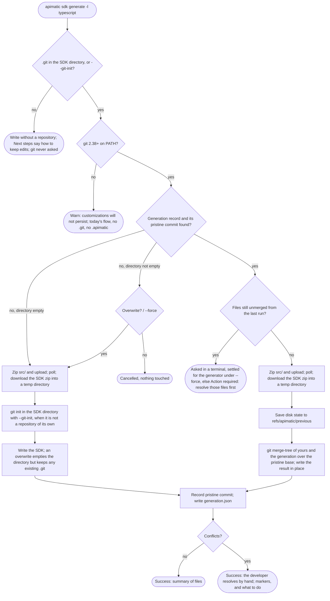
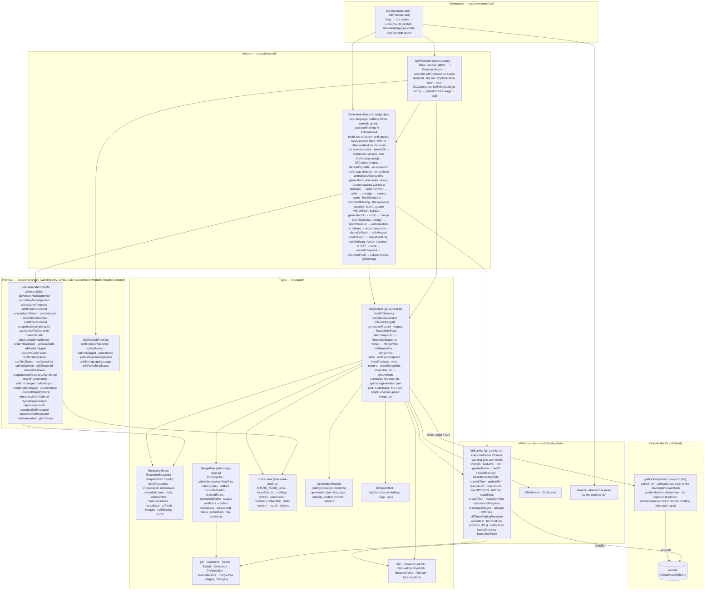

# Plan: keep your edits when regenerating an SDK

Status: implemented on branch `asadali214/custom-code-redesign`, cut from `dev` at
`dc3235a1`, in nine vertical slices (phases 0 to 8 of `custom-code-phases.md`) between
2026-10-30 and 2026-11-03, after a first attempt on `asadali214/custom-code-injection` (PR #445)
whose review decided the rules in section 2; PR #465 into `dev`. Section 8 lists the phases and
their commits, section 9 the files, section 10 the architecture, layer by layer; section 11 lists
what still needs a decision. The design was tested against Speakeasy's generator first; section 7
records what that lab measured and what this plan does on the same cases, and the APIMatic
Customization Lab replays them on the real CLI.

## 1. Goal and scope

A developer edits a generated SDK, any file and any line, and regenerates it with the same
command; their edits survive, the generator's changes arrive, and the two are merged file by
file with git's three-way merge. Nothing to configure, no markers or regions to stay inside,
no commit required before regenerating.

What changes for the developer:

- **Git is required.** The CLI uses the git on `PATH`, 2.38 or newer, for the snapshots and
  the merge. It looks for git only when the SDK directory has a repository of its own (a
  `.git` in it) or `--git-init` will make one; anywhere else there is nothing for git to keep,
  so a machine without git sees nothing about it. Without it `sdk generate` behaves exactly
  as before, writes no `.git` and no `.apimatic/`, and warns: "git was not found, so your
  customizations to the generated SDK will not persist across regenerations".
- **First run**: as before, a spec and a language; the SDK lands in `<project>/sdk/<language>`,
  or in the `--destination` itself when one is named, with no language directory added below it.
  If that directory is not a git repository of its own, `--git-init` makes it one; without the
  flag the SDK is written without one, and the run ends with next steps for a developer who
  wants to customize it: rerun with `--git-init` before changing anything, then make the
  changes. A repository
  that only encloses the directory, such as the project's, is never used.
- **A clone**: `--destination` naming a clone of an SDK repository regenerates over the clone,
  and merges when the clone holds a generation record. A destination holding the project's
  `src` is refused, since the SDK directory is emptied before a write that does not merge.
- **Regenerate in place**: the same command. Generator changes are merged into edited files,
  new files are added, files the generator stopped producing are removed when unedited.
- **Conflicts are explicit**: overlapping changes are listed before anything is written, and a
  terminal run asks how to settle them (6.1); `--force` takes the generator's changes. Resolving
  by hand leaves git-style markers, put in git's index for a merge tool. Resolve, rerun.
- **Teams**: every recorded run makes sure a `pre-push` hook is in place, and from then on every
  push of a branch also pushes the snapshot refs; a clone fetches them before merging. The CLI
  never pushes (3.2).
- **No base, no merge**: an SDK directory with no generation record, or whose recorded
  snapshot is missing, gets the "overwrite?" question as before; the run then records a
  snapshot so the next one merges.

Terms, also in `CONTEXT.md`: the **SDK directory** is the directory the CLI writes into (the
`--destination` as named, else `sdk/<language>`), input and output of every later run; the **repository** is the SDK
directory's own git repository, rooted at it; a **pristine snapshot** is one generation's output exactly as the
server returned it, stored as a commit under a hidden ref; the **generation record** is
`<sdk>/.apimatic/generation.json`, naming the snapshot the directory was last written from;
**custom code** is whatever differs between the SDK directory on disk and its snapshot.

Out of scope: an ignore list for files the developer wants frozen, patch files, code regions,
portal downloads that include custom code (section 11), and any push by the CLI itself.

## 2. Decisions

| Ask | Decision | Why |
|---|---|---|
| Where the merge runs | In the CLI, against the working tree. The server is unchanged. | Nothing is uploaded or downloaded beyond the SDK zip, the merge sees uncommitted edits, and the design matches Speakeasy's, which the lab showed working. |
| When it merges | Always, whenever git is available, the SDK directory is a git repository of its own and has a generation record. No switch in `apimatic.json`. | One rule to explain: "with git installed, your edits are kept". A switch would be read only after the first edit is already lost. |
| Git is a hard requirement | The system git, 2.38 or newer, found on `PATH`, looked for only when the SDK directory has a `.git` of its own or `--git-init` will make one (2026-10-30; every run looked before). Absent or older: today's flow, no `.git` or `.apimatic/` written, one warning. No bundled fallback engine. | Git's merge is the reference everyone else measures against: rename detection, modify/delete and add/add semantics, binary handling. Generators that embed a library write their own diff3 (Speakeasy, isomorphic-git); tools that accept git as a prerequisite shell out to it (JHipster, Copier, Cruft); none reimplements rename detection. 2.38 (October 2022) is the first with `merge-tree --write-tree`. |
| No repository | `--git-init` makes the SDK directory a repository: `git init -b main` there after the generation succeeds and before the first write, reported afterwards. Without it the SDK is written without a repository, exit 0, however the run started, and a "Next steps" box after the write says how to keep edits, should the developer make any: rerun with `--git-init` before changing anything (it needs git 2.38 or newer), then make the changes (decided 2026-10-29 on the product review, replacing the question of 2026-10-27; the steps replaced a warning printed before the upload the same day, and were worded on 2026-10-30 not to assume the SDK will be edited). `sdk publish` always passes it when run with flags, and takes `--git-init` in its step-by-step experience. A non-empty directory without a repository is asked "overwrite?" first. | Without a snapshot of the first generation there is nothing to merge against later, but a repository nobody asked for inside `sdk/<language>` trips `git add .` once the project becomes a repository of its own, and CI should never get one by surprise. A flag says so up front, where the question could not be answered in CI at all. |
| Only the SDK directory's own repository | A repository counts only when its root is the SDK directory. One that encloses it from above, the project's or any other, is treated as none: nothing is written into it, no refs, no hook (decided 2026-10-29 on the product review). | The CLI should not keep refs and a hook in a repository the developer keeps for something else. The cost: inside a project repository, `--git-init` makes the SDK directory an embedded repository, which the project then tracks as a gitlink rather than as files. |
| Repository found but no record | Ask "overwrite?" as before (skipped by `--force`); then record a snapshot, saying once that the repository was found. | An SDK generated by an older CLI, copied in, or built from the portal has no base. |
| Record for another generation | A record for another stability (or generator) is "no base": the overwrite question, then a fresh snapshot. No warning about what the directory holds (removed 2026-10-29 on the product review). | Merging a beta generation over a stable base would be a merge of everything; replacing is what the developer asked for. |
| Remote | Read only by the CLI, and only when a record names a commit the repository lacks. Writing is the developer's `git push`, through a `pre-push` hook the CLI installs (decided 2026-10-22, replacing the push inside the CLI). | A snapshot pushed by the CLI reached the remote before the branch that records it, and never when the push failed or the remote came later; the hook ties the snapshot to the push of the branch, so the two arrive together, every time. |
| Merge engine | `git merge-tree --write-tree` between two temporary commits (yours and the generation) that share the pristine snapshot as parent, run with the CLI's own `-c` settings. The CLI reads the result and writes it into the SDK directory. | No merge code to maintain; git supplies the three-way merge, rename detection and every conflict shape, without touching the working tree, the index or any branch. |
| Branches | None. Snapshots are commits under `refs/apimatic/…`, never checked out, never on a branch. | The CLI should not create or switch branches in someone's repository. The base for a run is the one the committed record names, so each branch carries its own. |
| Moves and renames | Git's rename detection, both ways, at its usual 50% similarity. | The lab's case 6 lost edits because Speakeasy relies on a header comment; git pairs by content. |
| Same path added by both | A conflict, unless the contents are identical. | Git semantics; Speakeasy overwrites the developer's file silently. |
| Generator drops an edited file | A conflict: the file stays, listed as "no longer generated". | Lab case 7: Speakeasy deletes it with no warning. |
| Developer deleted a file the generator changed | A conflict: the new version is written back and listed. Needs sign-off, section 10. | Git semantics. The alternative, remembering the deletion, is silent and recurs on docs files. |
| `--force` | Keeps its meaning: never ask. On conflicts, this run's or those the last run left unresolved, it takes the generator's changes, as "Resolve using generator changes" does (decided 2026-10-29 on the product review). A recorded SDK it cannot merge into, whose record names another generation or a missing snapshot, is replaced, with one warning after the write that the customizations were not carried over (decided 2026-10-29, replacing the refusal). | CI runs already pass it, and a forced run should end with an SDK that builds. What a replacement drops, the developer's commits still hold. |
| Undo | Not offered by the CLI (decided 2026-10-23). The SDK directory as it was before the run is still kept under `refs/apimatic/previous`, overwritten each run, for a developer to restore by hand. | The first question can cancel before anything is written, so a way back is needed only after a run that could not ask; the ref covers that at the cost of one commit per run. |
| Conflicts in git's index | The conflicted paths are put into the repository's index at stages 1, 2 and 3. | `git status` says "both modified" and `git mergetool` opens them, as after a merge git ran itself. |
| One action | `GenerateAction` is the whole run: no `SdkPrepareAction`, no `SdkWriteAction` (decided 2026-10-22). | Each phase had one caller and could not run alone, and passing `SdkDestination` between actions through `ActionResult.getValue()` put data on a result that is meant to carry only an outcome. |
| Functional core, imperative shell | `execute` is the script of the run, read top to bottom, and the only place that speaks: every question and message is a `this.prompts.*` call in it, every fact a `const`, and the action has no other method. The prompts word the data they are handed and never derive a fact or a policy of their own; where a message depends on an outcome, the core answers with a value that carries it, and the prompt calls its `match` with one handler per outcome (`SnapshotFetch`, `ShareHook`; amended 2026-10-28 on review, and 2026-11-03 for the redesign, where the discriminated unions became such values). The I/O is on one context, `GitContext` (`inspect`, `fetchSnapshot`, `merge`, `settlementFor`, `write`, `recordSnapshot`, `shareOnPush`, `archiveForUpload`); the decisions are pure values in `src/types/sdk/`: `RepositoryState`, `RecordedSnapshot`, `MergePlan.taking` and `settled`, `UnresolvedFile.settledFor`, `ShareHook.found` (decided 2026-10-22). | The reader of `execute` sees what is asked and said, and when, without a hop; what a repository state or a conflict choice means is testable without git or a terminal; the context stays silent, so it can be composed. |
| Telemetry | None for now. `SdkMergeConflictedEvent`, `ConflictOutcome` and the result's payload are gone; `execute` returns a plain `ActionResult` (decided 2026-10-22). | An `ActionResult` carries no data. Conflict counts can come back later through a callback the command hands the action, as `sdk publish` does with `onPublishSdkError`. |
| One context | `GitContext` is git on the SDK directory, built on the directory whether or not it is a repository: `hasGitDirectory` reads the disk, `isRepository(git)` answers as the git it is handed sees it (false, with no git run, without a `.git` of its own or a git that can serve), and every other method takes the directory as its root (decided 2026-10-30 on the redesign's Phase 1 review, replacing the two classes of 2026-10-22, `SdkContext` over `SdkRepositoryContext`). | The two-class seam made every git method ask for a root that may not be there, or carry a found repository through the action. With `inspect` answering "not a repository" as one state of a `RepositoryState`, the action reads one value, every fact in it is a `const`, and no run flag reaches a context. |

## 3. What is saved, and where

Two hidden refs in the SDK directory's own repository plus one small file inside it (one SDK
directory per repository since 2026-10-29, so the refs carry no path).

| Item | Holds | Written | Shared |
|---|---|---|---|
| `refs/apimatic/pristine` | A chain of commits, one per generation. Each tree is that generation's output exactly as unzipped: no `.git`, no `.apimatic/`, no developer files. | After every successful write, with plumbing: the generated directory is added to a temporary index (`GIT_INDEX_FILE`, `--work-tree`), then `write-tree`, `commit-tree` and `update-ref`. Author "APIMatic CLI <developer@apimatic.io>", message `apimatic: pristine typescript v4 stable`. | Pushed to the remote after every recorded run; fetched by a run whose record names a commit the repository lacks (3.2). |
| `refs/apimatic/previous` | One commit, no parent: the SDK directory as it was on disk the moment before the last run wrote to it (`.git` excluded). | Before the merge writes anything. Overwritten each run. | No. Local safety net: `git restore --source=refs/apimatic/previous --worktree -- .`, run in the SDK directory, puts the files back, record included (verified in the lab, case 15); files the run added stay and `git status` lists them. |
| `<sdk>/.apimatic/generation.json` | `schemaVersion`, `language`, `codegenVersion`, `stability`, `pristine` (the commit the directory was written from); nothing that changes from run to run, so a regeneration that changed nothing leaves it untouched (`generatedAt` and `cliVersion` dropped 2026-10-27 on review; older records still parse). The files a run leaves in conflict are not in it: they are git's unmerged index entries, the only state that says when the developer has resolved them. | After the pristine commit exists, so the two never disagree; `.apimatic/.gitattributes` (`generation.json merge=binary linguist-generated=true`) first, each only when its content changed. | Yes: an ordinary tracked file, committed with the SDK. It is what makes a branch, a worktree or a clone merge against the right base. The attributes keep a pull where two clones both regenerated from writing markers into it (section 11). |

### 3.1 Which snapshot is the base

The commit named in the generation record on disk, never the ref's tip. The tip only says
where the chain continues. If the named commit is absent locally, the CLI fetches the ref from
the remote (3.2) and looks again; if it is still absent, it says so and why (no remote, the
remote lacks it, or the fetch failed and how), and offers to overwrite instead, which records a
fresh snapshot. The commit id and the ref are not shown: nothing in the message is for the
developer to act on beyond the question that follows.

### 3.2 Sharing through a pre-push hook

The snapshot reaches the remote at the same moment the record does: when the developer pushes
a branch. After every recorded run the CLI writes two things (`GitContext.shareOnPush`): the script,
`apimatic-pre-push`, into git's own hooks directory (`git rev-parse --git-common-dir`, so
worktrees share it, whatever `core.hooksPath` says; `SHARE_HOOK_SCRIPT` in
`src/types/git-context.ts` beside the record's attributes, rewritten only when its content
changed), and a three-line marked block in `pre-push` that calls it (`# >>> apimatic snapshots`
… `# <<< apimatic snapshots`): a fresh hook when there is none, right after the shebang of an
existing shell hook (so an early `exit` below cannot skip it), and left alone when the block is
there. `ShareHook.found` (`src/types/sdk/share-hook.ts`) decides which from what is on disk and
answers one of five outcomes, which the one `shareHook` prompt words. The run that writes the
call into the hook says so, once; later runs are silent about it (decided 2026-10-27 on review).
The CLI never pushes.

The call is one line that finds the script through git, does nothing where the script is not
there (a clone that never ran the CLI) and never fails the push:
`f="$(git rev-parse --git-common-dir)/hooks/apimatic-pre-push"; [ -f "$f" ] && sh "$f" "$@" || true`.
That is what makes the other cases a one-step note rather than a warning with nothing to do.

The script, for the remote git passes as `$1`: nothing when the push carries the ref itself (git
lists what is pushed on the hook's stdin, so pushing it by hand still works); else push
`refs/apimatic/pristine`, when there is one, with `--no-verify` (so the push inside the hook does not re-enter the hook) and
`GIT_TERMINAL_PROMPT=0`; when that is rejected, fetch the remote's chain with
`+refs/apimatic/pristine:refs/apimatic/remotes/<remote>/pristine`, fast-forward or join the
local chain with a two-parent commit (`apimatic: pristine chains joined`), and push again. A second failure prints one line in the server's words; the script
always exits 0, and runs in its own `sh`, so a hook's `set -e` cannot be tripped by it. The
common push costs one extra push of small refs; the fetch happens only when another machine
pushed first.

A tracking name, not the local chain, is what the fetch writes to: a plain
`refs/apimatic/pristine` refspec made a diverged chain reject the fetch and `git pull` skip
its merge, and a forced one would strand unpushed snapshots.

When `core.hooksPath` is set, the CLI does not write the hook (husky regenerates `.husky/_` on
install, and the team's versioned `.husky/pre-push` is theirs). The run shows a next-steps note
naming the file that hook runs (`.husky/pre-push` for a hooks path ending in `_`, else
`<hooksPath>/pre-push`) and the line to add; once that file mentions the script, the note
stops. The same note, without the commit step, when the existing `.git/hooks/pre-push` is not
a shell script.

The CLI's only remote operation is `GitContext.fetchSnapshot`, a step after the refusals and the
unresolved block, when the record names a commit the repository lacks: from the branch's remote (`branch.<name>.remote`) else `origin`, without
prompts, with a 30-second timeout, and joining the local chain when it had diverged. A
snapshot that is nowhere is reported as missing and the run asks before replacing.

### 3.3 Rules

- Only a repository rooted at the SDK directory holds its snapshots. An SDK directory inside
  another SDK's repository is, for the CLI, a directory without one (decided 2026-10-29,
  replacing the refusal of a nested SDK directory, which per-path refs needed).
- `.git/` is never part of a snapshot. `.apimatic/` is in a previous snapshot (so a restore
  by hand puts the record back too) but never in a pristine one, and the merge leaves it
  alone since only the disk side has it.
- A snapshot of the disk honours the SDK's own `.gitignore` (so a `node_modules` or `dist`
  never enters a tree), except that every path the pristine snapshot holds is added
  regardless, so a generated file an ignore rule happens to match is still seen and never
  mistaken for one the developer deleted.
- The developer's git configuration is bypassed: every git call runs with
  `-c core.autocrlf=false`, `-c merge.conflictStyle=merge`, `-c merge.renormalize=true`,
  raised rename limits, `gc.auto=0`, a temporary attributes file holding `* text=auto`, and
  `LC_ALL=C`, with `GIT_DIR`, `GIT_WORK_TREE` and `GIT_INDEX_FILE` cleared from the environment,
  so two machines produce the same trees and the same markers, git's messages stay parseable,
  and a hook that runs the CLI cannot hand it another repository.
- Snapshots are ordinary git objects: deduplicated, packed by the developer's own `git gc`,
  invisible to `git log` and to a plain `git push`.
- `.apimatic/` never ships inside a published package: the three v4 generators' manifests are
  whitelists that do not name it (verified 2026-10-20, section 10).

## 4. One run of `apimatic sdk generate`

### 4.1 Before this plan

The destination was checked before anything was uploaded, and a non-empty one was emptied
before the fresh SDK was copied in. Nothing on disk survived a regeneration.

### 4.2 With this plan



The run is one action, `GenerateAction.execute`, read top to bottom; every question and
message is in it (section 10). It validates as before, then reads what git says about the SDK
directory, before the upload:

1. A `.git` in the SDK directory, a folder or a worktree's file, looked for on disk
   (`GitContext.hasGitDirectory`). Without one and without `--git-init`, git is never run and the
   version held is `GitVersion.none()` (decided 2026-10-30 on the product review; until then every
   run began with `git --version`). Otherwise `GitService.version`: absent, or older than 2.38,
   warns that customizations will not persist, and the run writes without a repository, no `.git`
   and no `.apimatic/` added.
2. `GitContext.inspect(git, language, stability)` answers one `RepositoryState`: not a repository
   (no `.git` of its own, a git that cannot serve, or git's top level above the directory), else
   the operation it is in the middle of (a merge, rebase, cherry-pick or revert is refused), the
   paths git still holds as unmerged, whether a record is there, and the snapshot the record
   names for this generation with whether it is held (`RecordedSnapshot`).
3. Unmerged files: asked about, settled for the generator under `--force`, or refused without a
   terminal (6.1). Then `GitContext.fetchSnapshot` brings a snapshot the clone lacks from its
   remote (3.2). A snapshot held: `merge` against it. No repository, no record, a record for
   another generation, or a snapshot still missing: a save, recorded when the directory is or
   becomes a repository of its own.
4. The overwrite question is asked before a save that would remove anything from the directory,
   never before a merge, and never with `--force`. Every entry but `.git` counts, hidden ones
   included, since the save keeps only `.git`: a repository of the developer's own that holds
   only `.github` or `.husky` is asked about, one that holds only `.git` is not
   (`GitContext.hasFilesBesidesGit`, `FileService.hasEntriesExcluding`).

It asks the overwrite question, uploads, polls and downloads into a temp directory as
before, and puts the SDK in place the way the facts say:

- A save: `GitContext.save` replaces what the directory holds, except its `.git`; with
  `--git-init` and no repository of its own, `GitService.init` first (after the generation
  succeeded, so a failed one leaves no repository behind), then `recordSnapshot` and
  `shareOnPush`; "Found a git repository" when the repository was already there and held no
  record. Without the flag, the save alone, with the Next steps. A failure to record is a
  warning: the SDK is on disk, and the next run asks before replacing it. With `--force`, a
  directory whose record names another generation or a missing snapshot is replaced all the
  same, and the run warns after the write that the customizations were not carried over
  (`recordedSdkReplaced`): `--force` answers for the developer.
- A merge: `GitContext.merge` (the generated tree, the disk tree, `merge-tree`) into a
  `MergePlan`; its conflicts settled by the answer to the question (6.1, `MergePlan.taking`);
  `keepPrevious`, then `write` (the previous ref, then the writes and deletions: only paths whose
  content differs between the disk and the merged tree; the directory is never emptied, and a
  write that fails is undone by `restore`); `recordSnapshot` and `shareOnPush`; the summary.
  With conflicts: the stages into the index, the steps, and Action required.

## 5. The merge, file by file

Three trees: base (the pristine snapshot), yours (the SDK directory on disk, snapshotted as
in 3.3) and new (the fresh generation). Yours and new are written as temporary commits whose
parent is the base, so `git merge-tree --write-tree yours new` finds the base itself and
returns a merged tree, the conflicted paths with their stages, and one informational line
per conflict naming its kind. The CLI does none of the deciding:

| Base | Yours | New | Action |
|---|---|---|---|
| absent | absent | present | Write it (new generated file). |
| absent | present | present | Identical: nothing. Different: conflict add/add, markers around both versions. |
| present | = base | present | Write the new version (you never edited it). |
| present | edited | = base | Keep yours (the generator did not change it). |
| present | edited | = yours | Nothing. |
| present | edited | changed | Three-way line merge. Non-overlapping: write the merged file. Overlapping: conflict markers. |
| present | absent | = base | Stays deleted. |
| present | absent | changed | Conflict "deleted by you, changed by the generator": the new version is written back and listed. Section 10. |
| present | = base | absent | Delete it (the generator no longer produces it). |
| present | edited | absent | Conflict "no longer generated": your file stays and is listed. |
| present | absent | absent | Nothing. |
| absent | present | absent | Your own file: never touched. |

Renames: git's detection on both sides at its default 50% similarity, with `merge.renameLimit`
raised. The generator renamed a file: your edits are merged into it at the new name and the
old name is removed. You moved a file: the generator's change to the old name is merged into
your file where it is now. A file both sides renamed differently is a rename conflict git
reports; the CLI lists it with git's message, and both candidates stay on disk.

Content: trees are stored with `* text=auto` and merged with `merge.renormalize`, so a CRLF
file and its LF counterpart compare as equal and merge line by line; a file the merge changes
is written with LF, a file it leaves alone keeps its ending. Binary files are git's binary
files: unedited ones are replaced, edited ones are kept, and an edited one the generator also
changed is a conflict that keeps yours.

## 6. Conflicts

The merge finishes for every file; a conflict in one file does not stop the others. A line
conflict is written into the file, with git's labels (the temporary commit ids) replaced as
the file is written:

```
<<<<<<< Your changes
 * Price in USD, VAT included.
=======
 * Retail price in US dollars.
>>>>>>> Generated by APIMatic
```

The other kinds carry no markers: a file no longer generated stays as yours; a file you
deleted comes back in its new version; a binary keeps yours. All are listed before the
question in a block, "N files need your attention", each with what happened to it and
nothing about how it will be written (decided 2026-10-29 on the product review). When the
developer resolves by hand, the steps follow the summary: resolve them in a merge tool
(`git mergetool`, or the editor's merge view) or by hand, naming the files with markers (keep
what is right, remove the markers, stage each) and those without (decide whether each stays
or goes, stage that); then rerun the command. The rerun asks how to resolve whatever is still
unresolved, so the steps do not offer that themselves (2026-10-30). The merge tool is left out
when the conflicts could not be put in the index. Git's own tools apply throughout:
`git status` lists the files as both modified, `git mergetool` opens them, `git add` marks
them resolved. The steps do not name
`refs/apimatic/previous`; that ref is the safety net of section 3, named only when a write
failed and could not be undone.

The run ends as Action required (`ActionResult.actionRequired()`, closed in yellow), exit 1
(decided 2026-10-29, replacing the success of the product review; named Conflicted until
2026-10-30, renamed so the state is not tied to conflicts): not a success, since the SDK holds
markers and will not build, and not a failure, since the run did what was chosen. The exit
code is the one `git merge` gives conflicts, so a command chained after the run does not run.
`sdk publish` stops on such a generation before zipping, so markers are never uploaded or
recorded as published, and ends as Action required too. A run without a terminal never writes
markers; it stops with the list, failed, exit 1. Nothing is lost: every other file is already
updated, the pristine snapshot is recorded, the index holds the conflicted paths.

The next run: while git still holds any file below the SDK directory as unmerged
(`GitService.unmergedStages`, `ls-files -u`), the run stops before generating and names them
(or asks, 6.1). That is git's own convention: the three stages stay in the index until
`git add` (or a mergetool, or an IDE's accept button) marks the file resolved, and `git commit`
refuses until then. The CLI reads nothing else: not the marker text, which a developer may
legitimately write and which an unstaged resolution still lacks, and not a list in the record,
which would carry a local, transient state in a committed file. Once resolved and staged, no
commit is needed. With the spec unchanged the rerun changes nothing, because new equals base.
With a changed spec it merges onto your resolution.

### 6.1 The questions

Conflicts are settled before anything is written. The plan is computed first (generated
tree, disk tree, `merge-tree`); when it has conflicts, a terminal is attached and `--force`
is absent, the action lists the conflicted files with their kind and asks
(`SdkGeneratePrompts.conflictChoice`, a `select`):

- **I'll resolve them myself**: the run goes on as above, markers, the steps (ending with "Or
  rerun and let the CLI resolve what is left, using either side."), success. `--force` answers
  "Resolve using generator changes" instead, without asking; a run without a terminal stops
  with the list and writes nothing.
- **Resolve using generator changes**: every marked block is settled for the generator's
  side as the file is written (`MergePlan.taking`, the same marker rule the next run uses on a
  file left unresolved, `UnresolvedFile.settledFor`), so only the overlapping hunks go the generator's way and your other edits
  in the same file survive; a file one side deleted, or a binary one, is settled whole by
  `MergePlan.taking('generated')`: the generator's version where it has one, else yours
  stays, so a customized file the generator dropped is never thrown away by this answer.
- **Resolve using my changes**: the mirror image: every marked block keeps your lines and the
  generator's other changes in the same file still apply; a file left whole stays as it is on
  disk, which is your side (`MergePlan.taking('yours')`), so a file you deleted stays deleted
  and a customized file the generator dropped stays. The next run sees your lines as your
  edits and keeps them.
- **Cancel this run**, or backing out of the question: nothing written, nothing recorded, no
  previous ref saved; the result is cancelled. The previous ref is saved only after the
  decision, so this answer leaves no trace.

For either side the plan is taken for that side (`MergePlan.taking(side)`), which remembers
the files the merge left in conflict (`conflictedPaths`) so the run can name them, under "Resolved
using …", once they are written; it records a clean snapshot and succeeds. The merge runs
once: `merge-tree -X ours|theirs` would need git 2.43, and settling the markers as the file
is written gives the same result on 2.38.

The next run, while git holds any of the SDK's files as unmerged, asks before generating
(`SdkGeneratePrompts.unresolvedChoice`); `--force` settles them for the generator without
asking, and a run without a terminal names them and ends as Action required, exit 1:

- **I'll finish resolving them**: nothing done; the run ends as Action required, exit 1
  (decided 2026-10-29, replacing the cancellation of the product review, which replaced a
  failure).
  Backing out of the question cancels, exit 130, as it does at every other question.
- **Resolve remaining conflicts using generator changes** and **… using my changes**:
  `GitContext.settlementFor(side, paths)` reads the two sides git kept in the
  index (`GitService.unmergedStages`, stage 2 yours, stage 3 the generator's) and settles each
  file through the pure `UnresolvedFile.settledFor`: markers still in it are settled in place for the side,
  keeping every line around them (what you already resolved in that file included); without
  markers, a file one side deleted stays or goes with the side asked for, a binary file takes
  that side's version, and a text file whose markers are all gone was resolved by hand and
  stays. The plan is written (`GitContext.write`) and every file taken out of the unmerged
  state (`GitService.unstage`); no network needed.

There is no undo and no cancel on this question (decided 2026-10-23): the first question
already offers the cancel, before anything is written. After either side, the directory is
inspected again, once; a file still unmerged after that is reported, never asked about
twice, and the run ends as Action required. The run then generates and merges from the settled state.

Nothing is reported to telemetry (section 2). Whether a question can be asked is
`terminal.isInteractive()` (`process.stdin.isTTY`, `src/infrastructure/terminal.ts`), which the
command reads and hands the action as `canAsk`; the actions' tests pass it directly.

CI: with `--force` nothing is asked; conflicts are settled for the generator and listed under
"Resolved using the generator's changes", and a recorded SDK the run cannot merge into is
replaced, with a warning. Without it, conflicts fail the job with the list. A CI checkout
fetches the snapshot it needs by itself; its push back usually fails for lack of a write
token, which is a warning. Opening pull requests is not the CLI's job; an Action that commits
the marked files to a branch for review is a separate piece of work.

## 7. Expected behaviour on the lab's cases

The eleven Speakeasy runs from the lab notebook, plus three the lab did not cover.

| # | Case | Speakeasy (measured) | This plan |
|---|---|---|---|
| 1 | Edit with nothing configured | lost unless the prompt is answered Yes | kept; there is nothing to configure |
| 2 | Edits and spec changes in different places | kept | kept |
| 3 | Same line changed by both | conflict markers, exit 1 | asked first; by hand: conflict markers, stages in the index for a merge tool, pre-run state kept |
| 4 | Developer adds new files | kept | kept |
| 5 | Developer deletes a generated file | stays deleted | stays deleted while the generator leaves it alone; conflict once the generator changes it (section 10) |
| 6 | Developer moves a generated file | lost: rewritten from scratch | kept: matched by content, merged at the new path |
| 7 | Generator drops an edited file | lost: deleted silently | conflict: file kept and listed |
| 8 | `.genignore` frozen file | drifts from the spec | not offered; an ignore list is a possible follow-up |
| 9 | Patch files | replayed every run | not offered; edits in place cover the need |
| 10 | Code regions | kept inside markers, lost outside | not offered; every line is editable |
| 11 | SDK hooks registration file | written once | unchanged: hooks are generator features, merged like any file |
| 12 | Both add the same path with different content | developer's file overwritten | conflict add/add |
| 13 | Generator renames an edited file | lost | kept: edits follow the rename |
| 14 | Fresh clone, regenerate | fails unless the hidden refs were pushed | merges by itself: the generating run pushed the ref, the clone fetches it; a clear message with the commands and the overwrite question only when the push had failed |

Every row of section 5 and this table is a test over real repositories in
`test/types/git-context.test.ts` (the merge table), `test/actions/sdk/generate-destination.test.ts`
(row 14 with a bare remote) and `test/actions/sdk/generate-merge.test.ts`, the last two driving
`GenerateAction` with a stubbed generation service (`test/helpers/sdk-generation.ts`).

## 8. Phases, as delivered

The first attempt (`asadali214/custom-code-injection`, PR #445, 2026-10-20 to 2026-10-30) was
reviewed into the rules of section 2 and the sequence of `custom-code-phases.md`, and rebuilt
from `dev` as vertical slices on `asadali214/custom-code-redesign`: each phase one behaviour a
developer can run, with the tests that prove it. The first attempt's history stays on
`asadali214/custom-code-rewrite` (`533bcf1a`, `92988f2f`), as reference only.

| Phase | Commit | A developer can |
|---|---|---|
| 0 | `d8a90a39` | generate into the SDK directory itself: `--destination` is the directory, `--api-version` and `--zip` are gone. |
| 1 | `bc516636` | make the SDK directory a repository with `--git-init`, and have the first generation recorded: `GitService`, `GitContext` (`hasGitDirectory`, `isRepository`, `inspect`, `save`, `recordSnapshot`), `GenerationRecord`, `RepositoryState`; git looked for only when wanted. |
| 2 | `82fd92db`, `7fcd38ff` | regenerate and have their edits merged, when nothing conflicts: `GitContext.merge`, `keepPrevious`, `write`, `restore`; `MergePlan`, the conflict kinds, markers and line endings; conflicts listed, not yet asked about. |
| 3 | `b2af733c`, `2e65e272` | choose how a conflict is settled, or resolve it by hand: `conflictChoice`, `MergePlan.taking`, the stages into the index, the steps; `ActionResult.actionRequired`; `sdk publish` stops on conflicts. |
| 4 | `b2892d93` | rerun after leaving conflicts, and be asked what to do with them: `unresolvedChoice`, `GitContext.settlementFor`, `UnresolvedFile`; a merge, rebase, cherry-pick or revert in progress refused. |
| 5 | `0eec5e8d` | regenerate in a clone, which fetches the snapshot it lacks: `GitContext.fetchSnapshot`, `RecordedSnapshot`, `SnapshotFetch`, the chains met; `.apimatic/.gitattributes`. |
| 6 | `48eaccf7` | push, and have the snapshots shared by a hook: `ShareHook`, `GitContext.shareOnPush`, the script, `hooksDirectory` and `hooksRunFrom`, the environment cleared. |
| 7 | this file | publish an SDK that keeps edits, uploading only what git would commit: `--git-init` on `sdk publish`, `GitContext.archiveForUpload`, `GitService.ignoredBelow`, `RelativeDirectoryPath`. |
| 8 | this file | read the docs for all of it: the terms, this document, the flag descriptions as the docs' CLI Reference has them, the conventions in `.ai`, the ESLint rule, the leftovers. |

Each phase ended with `tsc` on `src` and `test`, ESLint, Prettier on the touched files, its tests
and one full run of the suite, and was committed once reviewed. PR #465 into `dev`, to be
squash-merged, title `feat(sdk): keep your edits when regenerating an SDK`.

## 9. Files

| File | Role |
|---|---|
| `src/infrastructure/git-service.ts` | the system git behind every snapshot, the merge (its output read into stages and messages), the index, the remote (no prompts, 30 s), the hooks directories and what the ignore rules keep out; every call with the same `-c` settings and `GIT_DIR`, `GIT_WORK_TREE`, `GIT_INDEX_FILE` cleared; every method a `Promise<Result<T, string>>` carrying git's own words |
| `src/types/git-context.ts` | `GitContext`, the SDK directory under git: what the disk and git say (`hasGitDirectory`, `hasFilesBesidesGit`, `isRepository`, `generationRecord`, `inspect`), what the remote holds (`fetchSnapshot`), what a run plans (`merge`, `settlementFor`), how a plan lands (`save`, `archiveForUpload`, `keepPrevious`, `write`, `restore`), the snapshots it keeps (`recordSnapshot`) and how they are shared (`shareOnPush`); the refs, the record's attributes and the hook script as its constants |
| `src/types/sdk/repository-state.ts`, `recorded-snapshot.ts`, `snapshot-fetch.ts` | what `inspect` answers: the operation under way, the unresolved paths, whether a record is there, and the snapshot it names with whether it is held and, once the remote was tried, where else it was looked for |
| `src/types/sdk/merge-plan.ts`, `conflict.ts`, `conflict-markers.ts`, `unresolved-file.ts`, `file-content.ts` | pure: `MergePlan` built from git's merge and diffs, `taking(side)`, `settled`, the conflict kinds and their labels, the markers and their resolution for either side, how an unresolved file is settled from its stages, line endings |
| `src/types/sdk/share-hook.ts` | `ShareHook`: the call line, the markers, the script's name, and the rule over what is on disk, answering one of five outcomes for `match` |
| `src/types/sdk/generation-record.ts`, `write-problem.ts`, `stability-choice.ts`, `generate.ts` | the record file's content, a failed write named, the stability a flag chose, the languages and levels |
| `src/types/git/*` | git's output as types: `CommitId`, `TreeId`, `BlobId`, `GitVersion`, `GitOperation`, `RemoteName`, the merge-tree output, tree entries |
| `src/types/file/relativeFilePath.ts`, `relativeDirectoryPath.ts`, `relative-paths.ts` | paths as git spells them inside a tree, each kind its own type |
| `src/actions/sdk/generate.ts`, `src/prompts/sdk/generate.ts` | the run, its questions and its wording; `execute` the only place that speaks |
| `src/actions/sdk/publish.ts`, `publish/*.ts`, `src/prompts/sdk/publish.ts` | the publish runs the same generation with `--git-init` (always with flags, as asked in guided mode), stops on conflicts, uploads `archiveForUpload`, and its dry run says what the directory holds |
| `src/types/temp-context.ts`, `src/infrastructure/zip-service.ts` | a zip that leaves paths out |
| `src/infrastructure/file-service.ts` | bytes written only when changed, entries counted but `.git`, a hook made executable |
| `src/infrastructure/terminal.ts` | whether a question can be asked at all, read by the commands |
| `src/commands/sdk/generate.ts`, `publish.ts` | the flags (`--git-init`, `--force` as `FlagsProvider.sdkForce`), the docs' sentence on keeping your changes, guided mode on publish |
| `eslint.config.js` | `src/types/sdk`, `src/types/git` and `src/types/file` import no `fs`, process or infrastructure |
| `test/…` | mirrors each file above; the behaviour tests drive `GenerateAction` and `SdkPublishAction` with a stubbed generation service (`test/helpers/sdk-generation.ts`) over real repositories, under an empty global git config wherever hooks or ignore rules are read |

## 10. Architecture

Where each piece lives, by layer, and what calls what. Arrows are calls (or writes, where
labelled); the dashed subgraph is outside the CLI. This is the code, not the developer's flow
(that is section 4.2).



What each layer owns:

| Layer | Holds | Never does |
|---|---|---|
| Command | flags, intro/outro, whether a question can be asked (`terminal.isInteractive()`, handed down as `canAsk`) | git, files, questions, telemetry (none for now) |
| Actions | the imperative shell: `execute` with the order of the steps, every fact a `const`, every question and message spoken through `this.prompts` in it, and no other method on the action | wording, git commands, file I/O, data on the `ActionResult`, deciding what a state means, speaking through anything but its own prompts |
| Prompts | words and `select`/`confirm` for data they are handed; a value with outcomes (`SnapshotFetch`, `ShareHook`) worded through its `match`, one handler per outcome | derive a fact or a policy, know git refs |
| Types | the functional core: values that know their outcomes (`RepositoryState`, `RecordedSnapshot`, `MergePlan`, `UnresolvedFile`, `ShareHook`), and one context, `GitContext`, the SDK directory under git, which reads every fact first and answers data | print, call the API, ask |
| Infrastructure | `git`, the file system, zips | know what a snapshot or a conflict means |
| Outside | the hook script in the developer's `.git/hooks`, the remote's refs | need the CLI to run |

## 11. Needs a decision

- **Deleted by you, changed by the generator.** Conflict (this plan) or remembered deletion
  as Speakeasy does. The conflict recurs on docs files that change with every version bump;
  the memory is silent.
- **`git init` is a flag.** Decided 2026-10-29 on the product review, replacing the question
  of 2026-10-27, which had replaced the silent init: `--git-init` makes the SDK directory a
  repository, and without it every run writes without one and ends with the steps that make one. The silent init left a
  commit-less repository inside `sdk/<language>` that broke `git add .` once the project became
  a repository, and CI got a repository nobody asked for; the question could not be answered
  in CI at all.
- **No `directory()` on the SDK's context.** Decided on review (2026-10-27): `ProjectContext.sdkDirectory(language, destination)` is the one place a `--destination` becomes a path, for both SDK commands, and the action names the directory by what it was given, never by a second spelling.
- **The record merges as binary.** Decided 2026-10-23 after testing with two clones: both
  regenerated, so both changed `generatedAt`, and the second pull hit a text conflict in the
  record. `.apimatic/.gitattributes` sets `merge=binary`: git writes no markers, leaves the
  puller's record in place as valid JSON and lists it as both modified, so `git add` accepts
  it; either record names a snapshot a run can merge from. Under `git pull --rebase` the
  record left in place is the upstream one, equally valid. Weighed and set aside: `merge=union`
  (no conflict, but invalid JSON), a custom "keep ours" driver (silent, but it needs a
  `git config` line in every clone, and a clone without it falls back to markers). The
  fields that changed on every run, `generatedAt` and `cliVersion`, were dropped on review
  (2026-10-27): nothing read them, and a regeneration that changed nothing still showed the
  record as modified. `linguist-generated` collapses the record in GitHub's pull request diffs.
- **Unresolved conflicts are git's unmerged entries**, decided 2026-10-23 on review: the
  CLI asks the index (`ls-files -u` below the SDK directory) and nothing else, so a file
  counts as resolved exactly when `git add` has marked it so, as after any merge. A
  developer who discards the index (`git reset`, `git stash`) with markers still in the
  files has told git the files are resolved; the next merge then sees the marker lines as
  their edit and flags them again, so nothing is lost silently.
- **Packages must exclude `.apimatic/`.** No change needed, checked 2026-10-20: all three v4
  manifests are whitelists (`package.json` `files`, the `.csproj`'s explicit `Pack="true"`
  items, `[tool.poetry]` `packages`), and `npm pack`, `dotnet pack` and `python -m build` on
  projects with a planted `.apimatic/generation.json` packed none of it.
- **Portal downloads.** `portal generate` ships the server's SDK zips, so a portal's download
  never contains custom code. Zipping the merged SDK directory from disk is a follow-up.
- **Sharing by the CLI.** Decided 2026-10-21, reversing the earlier "no remote": the manual
  push and fetch was the step developers would forget and the one a clone could not do. The
  alternative weighed was a tracked `.apimatic/pristine/` copy (travels with every branch, but
  doubles the working tree and every diff); the remote push keeps the tree clean and makes the
  failure modes (no rights, no credential, offline) warnings with a manual fallback.
- **No `--offline` flag.** Decided 2026-10-21: the cases it guarded (a read-only remote, a
  policy against tool pushes, a dead network) are per-repository, not per-run, and every one
  of them is already a warning that does not fail the run. If an opt-out is ever needed, a git
  config read by `remoteOf` fits better than a flag.
- **The hook, not the CLI, pushes.** Decided 2026-10-22, replacing the push inside the CLI
  from the day before: a snapshot pushed by the CLI left the remote without it whenever the
  push failed or the remote was attached later, and nothing but another `sdk generate` would
  send it. Tying it to the developer's own push makes the snapshot and the record that names
  it arrive together. Weighed and dropped: a fetch refspec in the remote's config (the hook and
  the CLI fetch for themselves), writing into a `core.hooksPath` directory (husky wipes it),
  a fetch hook (git has none; `post-merge` fires only on pulls that merge, and a clone has no
  hooks yet).
- **Conflicts ask.** Decided 2026-10-22, reworded 2026-10-23 on review: the first run offers
  resolve by hand,
  resolve using generator changes or using my changes (hunk by hunk: each marked block is
  settled for the side as the file is written, which `merge-tree -X` would also do but only
  from git 2.43; never the whole file or SDK, since dropping what merged cleanly is more than
  asked), or cancel the run. The run after, while files are still unresolved, offers to
  finish resolving or to resolve what remains for either side; undo and cancel are not on it.
  `--force` answers for the generator on both questions (2026-10-29 on the product review,
  replacing markers as its default), so a forced run ends with an SDK that builds. No
  `--on-conflict` flag: nothing else was asked for.
- **No `--zip` flag.** Decided 2026-10-21: `sdk generate --zip` wrote the archive the server
  sent and nothing else, which custom code could never apply to, and nobody needs the CLI to
  zip a directory. Removed outright rather than hidden and deprecated. The server still delivers
  a zip, which the CLI unpacks into a temp directory; `portal generate --zip` is untouched.

## 12. Relation to other work

The codegen-v2 server-side plan (custom code as a git merge the server performs, with the
`.git` zipped up and down each run) is superseded by this one; the server's `/api/generate`
needs none of it, and the beta CLI never uploads a source tree. The v3 CLI flow
(`--track-changes`, `save-changes`, `merge-source-tree`) was removed from `dev` in #427 with
its `git-service.ts` and the isomorphic-git dependency; the file name returns here for the
system-git wrapper, and no library is added. Speakeasy's `persistentEdits` has the same shape
(snapshots as hidden refs in the developer's repository, per-file three-way merge on the
working tree, markers plus a failed exit on conflict), with the four gaps the lab found
closed: moves, generator renames, add/add, and dropped edited files.
