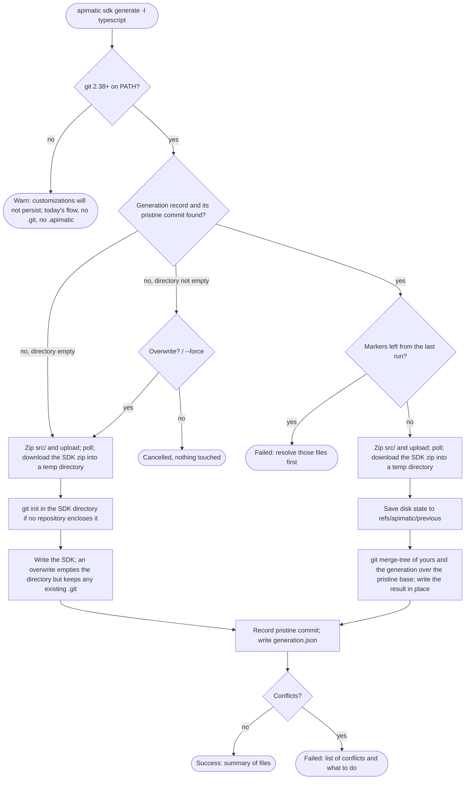
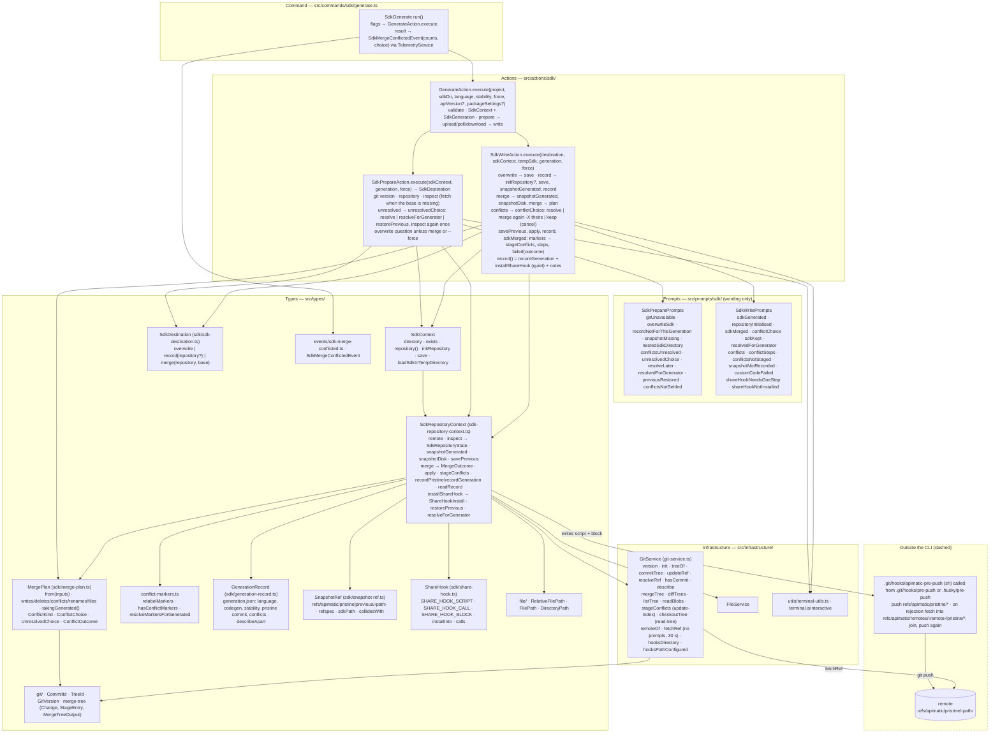

# Plan: keep your edits when regenerating an SDK

Status: implemented on branch `asadali214/custom-code-injection`, cut from `dev` at
`4baa9485`, in nine phases reviewed one by one between 2026-10-20 and 2026-10-22 (section 8
lists the commits); draft PR #445 into `dev`. Section 10 is the architecture, layer by layer;
section 11 lists what still needs a decision. The design was tested against Speakeasy's
generator first; section 7 records what that lab measured and what this plan does on the
same cases, and the APIMatic Customization Lab replays them on the real CLI.

## 1. Goal and scope

A developer edits a generated SDK, any file and any line, and regenerates it with the same
command; their edits survive, the generator's changes arrive, and the two are merged file by
file with git's three-way merge. Nothing to configure, no markers or regions to stay inside,
no commit required before regenerating.

What changes for the developer:

- **Git is required.** The CLI uses the git on `PATH`, 2.38 or newer, for the snapshots and
  the merge. Without it `sdk generate` behaves exactly as before, writes no `.git` and no
  `.apimatic/`, and warns: "git was not found, so your customizations to the generated SDK
  will not persist across regenerations".
- **First run**: as before, a spec and a language; the SDK lands in `<project>/sdk/<language>`.
  If no git repository encloses that directory, the CLI runs `git init` in it and says so.
- **Regenerate in place**: the same command. Generator changes are merged into edited files,
  new files are added, files the generator stopped producing are removed when unedited.
- **Conflicts are explicit**: overlapping changes get git-style markers, the run exits 1 and
  lists the files. Resolve, rerun.
- **Teams**: the first recorded run installs a `pre-push` hook, and from then on every push
  of a branch also pushes the snapshot refs; a clone fetches them before merging. The CLI
  never pushes (3.2).
- **No base, no merge**: an SDK directory with no generation record, or whose recorded
  snapshot is missing, gets the "overwrite?" question as before; the run then records a
  snapshot so the next one merges.

Terms, also in `CONTEXT.md`: the **SDK directory** is the `<language>` directory the CLI
writes into, input and output of every later run; the **repository** is the nearest git
repository enclosing it; a **pristine snapshot** is one generation's output exactly as the
server returned it, stored as a commit under a hidden ref; the **generation record** is
`<sdk>/.apimatic/generation.json`, naming the snapshot the directory was last written from;
**custom code** is whatever differs between the SDK directory on disk and its snapshot.

Out of scope: an ignore list for files the developer wants frozen, patch files, code regions,
portal downloads that include custom code (section 11), and any push by the CLI itself.

## 2. Decisions

| Ask | Decision | Why |
|---|---|---|
| Where the merge runs | In the CLI, against the working tree. The server is unchanged. | Nothing is uploaded or downloaded beyond the SDK zip, the merge sees uncommitted edits, and the design matches Speakeasy's, which the lab showed working. |
| When it merges | Always, whenever git is available, the SDK directory sits in a git repository and has a generation record. No switch in `apimatic.json`. | One rule to explain: "with git installed, your edits are kept". A switch would be read only after the first edit is already lost. |
| Git is a hard requirement | The system git, 2.38 or newer, found on `PATH` at the start of every run. Absent or older: today's flow, no `.git` or `.apimatic/` written, one warning. No bundled fallback engine. | Git's merge is the reference everyone else measures against: rename detection, modify/delete and add/add semantics, binary handling. Generators that embed a library write their own diff3 (Speakeasy, isomorphic-git); tools that accept git as a prerequisite shell out to it (JHipster, Copier, Cruft); none reimplements rename detection. 2.38 (October 2022) is the first with `merge-tree --write-tree`. |
| No repository | After the generation succeeds and before the first write, `git init -b main` in the SDK directory, reported afterwards. A non-empty directory without a repository is asked "overwrite?" first. | Without a snapshot of the first generation there is nothing to merge against later. The init is inside the developer's own destination directory. |
| Repository found but no record | Ask "overwrite?" as before (skipped by `--force`); then record a snapshot. | An SDK generated by an older CLI, copied in, or built from the portal has no base. |
| Record for another generation | A record for another stability (or generator) is "no base": a warning, the overwrite question, a fresh snapshot. | Merging a beta generation over a stable base would be a merge of everything; replacing is what the developer asked for. |
| Remote | Read only by the CLI, and only when a record names a commit the repository lacks. Writing is the developer's `git push`, through a `pre-push` hook the CLI installs (decided 2026-10-22, replacing the push inside the CLI). | A snapshot pushed by the CLI reached the remote before the branch that records it, and never when the push failed or the remote came later; the hook ties the snapshot to the push of the branch, so the two arrive together, every time. |
| Merge engine | `git merge-tree --write-tree` between two temporary commits (yours and the generation) that share the pristine snapshot as parent, run with the CLI's own `-c` settings. The CLI reads the result and writes it into the SDK directory. | No merge code to maintain; git supplies the three-way merge, rename detection and every conflict shape, without touching the working tree, the index or any branch. |
| Branches | None. Snapshots are commits under `refs/apimatic/…`, never checked out, never on a branch. | The CLI should not create or switch branches in someone's repository. The base for a run is the one the committed record names, so each branch carries its own. |
| Moves and renames | Git's rename detection, both ways, at its usual 50% similarity. | The lab's case 6 lost edits because Speakeasy relies on a header comment; git pairs by content. |
| Same path added by both | A conflict, unless the contents are identical. | Git semantics; Speakeasy overwrites the developer's file silently. |
| Generator drops an edited file | A conflict: the file stays, listed as "no longer generated". | Lab case 7: Speakeasy deletes it with no warning. |
| Developer deleted a file the generator changed | A conflict: the new version is written back and listed. Needs sign-off, section 10. | Git semantics. The alternative, remembering the deletion, is silent and recurs on docs files. |
| `--force` | Keeps its meaning: never ask. With a base it changes nothing, since nothing is asked. | CI runs already pass it. |
| Undo | The SDK directory as it was before the run is kept under `refs/apimatic/previous/…`, overwritten each run. | A merge that goes wrong on uncommitted edits would otherwise be unrecoverable. |
| Conflicts in git's index | The conflicted paths are put into the repository's index at stages 1, 2 and 3. | `git status` says "both modified" and `git mergetool` opens them, as after a merge git ran itself. |

## 3. What is saved, and where

Two hidden refs per SDK directory plus one small file inside it. `<path>` below is the SDK
directory relative to the repository root with forward slashes (`sdk/typescript`, or
`sdk/2.1.0/typescript` with `--api-version`); when the SDK directory is the repository root
the ref has no suffix.

| Item | Holds | Written | Shared |
|---|---|---|---|
| `refs/apimatic/pristine/<path>` | A chain of commits, one per generation. Each tree is that generation's output exactly as unzipped: no `.git`, no `.apimatic/`, no developer files. | After every successful write, with plumbing: the generated directory is added to a temporary index (`GIT_INDEX_FILE`, `--work-tree`), then `write-tree`, `commit-tree` and `update-ref`. Author "APIMatic CLI <developer@apimatic.io>", message `apimatic: pristine typescript v4 stable`. | Pushed to the remote after every recorded run; fetched by a run whose record names a commit the repository lacks (3.2). |
| `refs/apimatic/previous/<path>` | One commit, no parent: the SDK directory as it was on disk the moment before the last run wrote to it (`.git` excluded). Its tree is rooted at the SDK directory, not at the repository root. | Before the merge writes anything. Overwritten each run. | No. Local safety net: `git --work-tree=sdk/typescript restore --source=refs/apimatic/previous/sdk/typescript --worktree -- .` puts the files back, record included (verified in the lab, case 15); files the run added stay and `git status` lists them. |
| `<sdk>/.apimatic/generation.json` | `schemaVersion`, `language`, `codegenVersion`, `stability`, `pristine` (the commit the directory was written from), `generatedAt`, `cliVersion`, and `conflicts` (paths left with markers, empty on a clean run). | After the pristine commit exists, so the two never disagree. | Yes: an ordinary tracked file, committed with the SDK. It is what makes a branch, a worktree or a clone merge against the right base. |

### 3.1 Which snapshot is the base

The commit named in the generation record on disk, never the ref's tip. The tip only says
where the chain continues. If the named commit is absent locally, the CLI fetches the ref from
the remote (3.2) and looks again; if it is still absent, it says so and why (no remote, the
remote lacks it, or the fetch failed and how), and offers to overwrite instead, which records a
fresh snapshot. The commit id and the ref are not shown: nothing in the message is for the
developer to act on beyond the question that follows.

### 3.2 Sharing through a pre-push hook

The snapshot reaches the remote at the same moment the record does: when the developer pushes
a branch. After every recorded run the CLI writes two things into git's own hooks directory
(`git rev-parse --git-common-dir`, so worktrees share it, whatever `core.hooksPath` says): the
script, `apimatic-pre-push` (`SHARE_HOOK_SCRIPT` in `src/types/sdk/share-hook.ts`, rewritten
only when its content changed), and a three-line marked block in `pre-push` that calls it
(`# >>> apimatic snapshots v2` … `# <<< apimatic snapshots`): a fresh hook when there is none,
right after the shebang of an existing shell hook (so an early `exit` below cannot skip it),
replacing an older block, and left alone when the current one is there. Nothing is printed:
the hook is part of keeping customizations, not something a run announces. The CLI never
pushes.

The call is one line that finds the script through git, does nothing where the script is not
there (a clone that never ran the CLI) and never fails the push:
`f="$(git rev-parse --git-common-dir)/hooks/apimatic-pre-push"; [ -f "$f" ] && sh "$f" "$@" || true`.
That is what makes the other cases a one-step note rather than a warning with nothing to do.

The script, for the remote git passes as `$1`: push every `refs/apimatic/pristine/*` with
`--no-verify` (so the push inside the hook does not re-enter the hook) and `GIT_TERMINAL_PROMPT=0`;
when that is rejected, fetch the remote's chains into `refs/apimatic/remotes/<remote>/pristine/*`,
fast-forward or join each local chain with a two-parent commit (`apimatic: pristine chains
joined`), and push again. A second failure prints one line in the server's words; the script
always exits 0, and runs in its own `sh`, so a hook's `set -e` cannot be tripped by it. The
common push costs one extra push of small refs; the fetch happens only when another machine
pushed first.

Tracking names, not the local chain, are what the fetch writes to: a plain
`refs/apimatic/pristine/*` refspec made a diverged chain reject the fetch and `git pull` skip
its merge, and a forced one would strand unpushed snapshots.

When `core.hooksPath` is set, the CLI does not write the hook (husky regenerates `.husky/_` on
install, and the team's versioned `.husky/pre-push` is theirs). The run shows a next-steps note
naming the file that hook runs (`.husky/pre-push` for a hooks path ending in `_`, else
`<hooksPath>/pre-push`) and the line to add; once that file mentions the script, the note
stops. The same note, without the commit step, when the existing `.git/hooks/pre-push` is not
a shell script.

The CLI's only remote operation is the fetch inside `inspect`, when the record names a commit
the repository lacks: from the branch's remote (`branch.<name>.remote`) else `origin`, without
prompts, with a 30-second timeout, and joining the local chain when it had diverged. A
snapshot that is nowhere is reported as missing and the run asks before replacing.

### 3.3 Rules

- The ref name is the path, so an SDK directory nested inside another SDK directory is
  refused before anything is uploaded (the refs would collide).
- `.git/` is never part of a snapshot. `.apimatic/` is in a previous snapshot (so an undo
  restores the record too) but never in a pristine one, and the merge leaves it alone since
  only the disk side has it.
- A snapshot of the disk honours the SDK's own `.gitignore` (so a `node_modules` or `dist`
  never enters a tree), except that every path the pristine snapshot holds is added
  regardless, so a generated file an ignore rule happens to match is still seen and never
  mistaken for one the developer deleted.
- The developer's git configuration is bypassed: every git call runs with
  `-c core.autocrlf=false`, `-c merge.conflictStyle=merge`, `-c merge.renormalize=true`,
  raised rename limits, `gc.auto=0`, a temporary attributes file holding `* text=auto`, and
  `LC_ALL=C`, so two machines produce the same trees and the same markers and git's messages
  stay parseable.
- Snapshots are ordinary git objects: deduplicated, packed by the developer's own `git gc`,
  invisible to `git log` and to a plain `git push`.
- `.apimatic/` never ships inside a published package: the three v4 generators' manifests are
  whitelists that do not name it (verified 2026-10-20, section 10).

## 4. One run of `apimatic sdk generate`

### 4.1 Before this plan

The destination was checked before anything was uploaded, and a non-empty one was emptied
before the fresh SDK was copied in. Nothing on disk survived a regeneration.

### 4.2 With this plan



The run is three actions. `GenerateAction` validates as before and generates into a temp
directory. `SdkPrepareAction` runs before the upload and returns an `SdkDestination`:

1. `git --version`. Absent, or older than 2.38: warn that customizations will not persist;
   `overwrite`, writing no `.git` and no `.apimatic/`.
2. `SdkContext.repository()` finds the enclosing repository (from the
   nearest existing ancestor, since a first run's directory is not there yet), the nesting
   check, the record, whether its commit is present, and which listed files still hold
   markers. A nested SDK directory is refused here.
3. No repository, no record, a record for another generation, or a missing commit: `record`,
   each with its message. Markers left: refused. Otherwise `merge` against the recorded base.
4. The overwrite question is asked for `overwrite` and `record` when the directory holds
   files, never for `merge`, and never with `--force`.

After the download, `SdkWriteAction` writes it the way the destination says:

- `overwrite`: today's save into the directory; a `.git` in it stays.
- `record`: `git init -b main` in the SDK directory when nothing encloses it (after the
  generation succeeded, so a failed one leaves no repository behind), the save, then the
  pristine commit and the record. A failure to record is a warning: the SDK is on disk, and
  the next run asks before replacing it.
- `merge`: the generated tree, the previous ref, the disk tree, `merge-tree`, the writes and
  deletions (only paths whose content differs between the disk and the merged tree; the
  directory is never emptied), the pristine commit and the record, the summary. With
  conflicts: the stages into the index, the conflict block, and a failed result carrying the
  plan, which the command turns into a telemetry event of counts by kind.

## 5. The merge, file by file

Three trees: base (the pristine snapshot), yours (the SDK directory on disk, snapshotted as
in 3.3) and new (the fresh generation). Yours and new are written as temporary commits whose
parent is the base, so `git merge-tree --write-tree yours new` finds the base itself and
returns a merged tree, the conflicted paths with their stages, and one informational line
per conflict naming its kind. The CLI does none of the deciding:

| Base | Yours | New | Action |
|---|---|---|---|
| absent | absent | present | Write it (new generated file). |
| absent | present | present | Identical: nothing. Different: conflict add/add, markers around both versions. |
| present | = base | present | Write the new version (you never edited it). |
| present | edited | = base | Keep yours (the generator did not change it). |
| present | edited | = yours | Nothing. |
| present | edited | changed | Three-way line merge. Non-overlapping: write the merged file. Overlapping: conflict markers. |
| present | absent | = base | Stays deleted. |
| present | absent | changed | Conflict "deleted by you, changed by the generator": the new version is written back and listed. Section 10. |
| present | = base | absent | Delete it (the generator no longer produces it). |
| present | edited | absent | Conflict "no longer generated": your file stays and is listed. |
| present | absent | absent | Nothing. |
| absent | present | absent | Your own file: never touched. |

Renames: git's detection on both sides at its default 50% similarity, with `merge.renameLimit`
raised. The generator renamed a file: your edits are merged into it at the new name and the
old name is removed. You moved a file: the generator's change to the old name is merged into
your file where it is now. A file both sides renamed differently is a rename conflict git
reports; the CLI lists it with git's message, and both candidates stay on disk.

Content: trees are stored with `* text=auto` and merged with `merge.renormalize`, so a CRLF
file and its LF counterpart compare as equal and merge line by line; a file the merge changes
is written with LF, a file it leaves alone keeps its ending. Binary files are git's binary
files: unedited ones are replaced, edited ones are kept, and an edited one the generator also
changed is a conflict that keeps yours.

## 6. Conflicts

The merge finishes for every file; a conflict in one file does not stop the others. A line
conflict is written into the file, with git's labels (the temporary commit ids) replaced as
the file is written:

```
<<<<<<< Your changes
 * Price in USD, VAT included.
=======
 * Retail price in US dollars.
>>>>>>> Generated by APIMatic
```

The other kinds carry no markers: a file no longer generated stays as yours; a file you
deleted comes back in its new version; a binary keeps yours. All are listed by kind in a
block after the summary, "N files need your attention", with the steps: open each file, keep
what is right, remove the markers (`git status` lists them as both modified, `git mergetool`
opens them); rerun, nothing needs committing first; the pre-run state is under
`refs/apimatic/previous/…`.

The result is failed, so the exit code is 1 and scripts and CI notice; the outro says the
conflicts need resolving, not that generation failed. Nothing is lost: every other file is
already updated, the pristine snapshot is recorded, the record lists the conflicted paths.

The next run: while any listed file still holds the marker lines, the run stops before
generating and names them (or asks, 6.1). Once resolved, no commit is needed. With the spec
unchanged the rerun changes nothing, because new equals base. With a changed spec it merges
onto your resolution. Git's index keeps the three stages until `git add` resolves them, as
after any merge.

### 6.1 The questions

Conflicts are settled before anything is written. The plan is computed first (generated
tree, disk tree, `merge-tree`); when it has conflicts, a terminal is attached and `--force`
is absent, `SdkWriteAction` lists the conflicted files with their kind and asks
(`SdkWritePrompts.conflictChoice`, a `select`):

- **I'll resolve them myself**: the run goes on as above, markers, exit 1, and the steps
  (ending with "to undo this run instead, rerun and choose Undo the last generation"). The
  `--force` and non-interactive default, which prints the list with the steps as before.
- **Use the generator's changes where they conflict**: the merge is run again with
  `--strategy-option=theirs`, so every overlapping hunk goes the generator's way and your other
  edits in the same file survive; a file one side deleted is settled whole by
  `MergePlan.takingGenerated()` (the generator's version back, or the file removed). The run
  names the files, records a clean snapshot and succeeds.
- **Keep the SDK as it is**, or backing out of the question: nothing written, nothing
  recorded, no previous ref saved; the result is cancelled. The previous ref is saved only
  after the decision, so this answer leaves no trace.

The next run, while a listed file still holds markers, asks before generating
(`SdkPrepareAction`, `SdkPreparePrompts.unresolvedChoice`); `--force` and a run without a
terminal get the refusal as before:

- **I'll finish resolving them**, or backing out: nothing done, exit 1.
- **Use the generator's changes in the files still marked**:
  `SdkRepositoryContext.resolveForGenerator` settles each marker block in place for the
  generator's side, keeping every line around it (what you already resolved in that file
  included), and takes the file out of the unmerged state; no network needed.
- **Undo the last generation**: `SdkRepositoryContext.restorePrevious` puts the whole SDK
  directory back as `refs/apimatic/previous/<path>` holds it, record included, through
  `GitService.checkoutTree` (a temporary index, `read-tree --reset -u`): files the run added
  go, `.git` and ignored files are untouched.

After either, the directory is inspected again, once; a file still marked after that is
reported, never asked about twice. The run then generates and merges from the settled or
restored state, so an undo with an unchanged spec lands back at the first question.

The command fires `SdkMergeConflictedEvent` with the conflict counts and the choice
(`resolve` from the failed result, `generated` from the success value, through
`ConflictOutcome`); a kept SDK fires nothing. Whether a question can be asked is
`terminal.isInteractive()` (`process.stdin.isTTY`, `src/utils/terminal-utils.ts`), stubbed
in tests.

CI: with `--force` nothing is asked; conflicts fail the job with the same list. A CI checkout
fetches the snapshot it needs by itself; its push back usually fails for lack of a write
token, which is a warning. Opening pull requests is not the CLI's job; an Action that commits
the marked files to a branch for review is a separate piece of work.

## 7. Expected behaviour on the lab's cases

The eleven Speakeasy runs from the lab notebook, plus three the lab did not cover.

| # | Case | Speakeasy (measured) | This plan |
|---|---|---|---|
| 1 | Edit with nothing configured | lost unless the prompt is answered Yes | kept; there is nothing to configure |
| 2 | Edits and spec changes in different places | kept | kept |
| 3 | Same line changed by both | conflict markers, exit 1 | conflict markers, exit 1, pre-run state kept, stages in the index |
| 4 | Developer adds new files | kept | kept |
| 5 | Developer deletes a generated file | stays deleted | stays deleted while the generator leaves it alone; conflict once the generator changes it (section 10) |
| 6 | Developer moves a generated file | lost: rewritten from scratch | kept: matched by content, merged at the new path |
| 7 | Generator drops an edited file | lost: deleted silently | conflict: file kept and listed |
| 8 | `.genignore` frozen file | drifts from the spec | not offered; an ignore list is a possible follow-up |
| 9 | Patch files | replayed every run | not offered; edits in place cover the need |
| 10 | Code regions | kept inside markers, lost outside | not offered; every line is editable |
| 11 | SDK hooks registration file | written once | unchanged: hooks are generator features, merged like any file |
| 12 | Both add the same path with different content | developer's file overwritten | conflict add/add |
| 13 | Generator renames an edited file | lost | kept: edits follow the rename |
| 14 | Fresh clone, regenerate | fails unless the hidden refs were pushed | merges by itself: the generating run pushed the ref, the clone fetches it; a clear message with the commands and the overwrite question only when the push had failed |

Every row of section 5 and this table is a test over real repositories in
`test/types/sdk-repository-context-merge.test.ts`, `test/actions/sdk/prepare.test.ts` (row 14 with
a bare remote) and `test/actions/sdk/write.test.ts`.

## 8. Phases, as delivered

| Phase | Commit | What |
|---|---|---|
| 1 | `db3fe9f2`, reworked in `185e0663` | `GitService` (the system git through `execa`, every call with the 3.3 settings) and the pristine store (since the `SdkRepositoryContext`) with the value objects: refs, commit and tree ids, git version, generation record. |
| 2 | `185e0663` | The merge (since moved onto `SdkRepositoryContext`): the temporary commits, `merge-tree --write-tree -z`, the diffs; `src/application/sdk-merge/` (since folded into `GitService` and `src/types/sdk/`) keeps only what is pure: parsing merge-tree's output, the conflict kinds, marker relabelling, `MergePlan`. |
| 3 | `4d5b9ccf` | `SdkPrepareAction`, `SdkDestination`, `SdkWriteAction`, their prompts, the repository's `inspect`; `GenerateAction` back to validation and generation; `SdkContext.save` keeps `.git`. |
| 4, 5 | `87453917` | The missing-snapshot message with the push and fetch commands; `stageConflicts` through `update-index --index-info`; `SdkMergeConflictedEvent`. |
| 6 | this file | `CONTEXT.md` terms, the README section and requirement, the command description. |
| 7 | 8217ac56 | Sharing through the remote: `GitService.remoteOf`, `fetchRef`, `pushRef`, `isAncestor`; `SdkRepositoryContext.remote`, `shareSnapshot`, the fetch inside `inspect`, chains joined on divergence; the prompts; lab cases for a clone, a refused push, a remote attached after generating, and two diverged machines. |
| 8 | 7c181dfa | Sharing through a `pre-push` hook instead of a push in the CLI: the `apimatic-pre-push` script and the calling block (`ShareHook`), `GitService.hooksDirectory` and `hooksPathConfigured`, `SdkRepositoryContext.installShareHook`, the one-step note; `pushRef` and `shareSnapshot` removed; lab cases for `core.hooksPath` and an existing hook. |
| 9 | uncommitted | The conflict questions (6.1): `MergePlan.takingGenerated`, `ConflictChoice`/`UnresolvedChoice`/`ConflictOutcome`, `SdkRepositoryContext.restorePrevious` and `resolveForGenerator`, `GitService.checkoutTree`, `terminal.isInteractive`, the two `select` prompts and their follow-ups, the choice on the telemetry event; the README's custom-code section removed. |

PR into `dev`, squash-merged, title `feat(sdk): keep your edits when regenerating an SDK`.

## 9. Files

| File | Role |
|---|---|
| `src/infrastructure/git-service.ts` | the system git behind every snapshot, the merge (its output read into stages and messages) and the index staging |
| `src/types/sdk-repository-context.ts` | the SDK directory with its repository: snapshots, the record, `inspect`, the merge, its application to disk, the staging |
| `src/types/sdk/{merge-plan,conflict-markers}.ts` | pure: `MergePlan` built from git's merge and diffs, `takingGenerated`, conflict kinds, the choices, markers and their generator-side resolution |
| `src/types/sdk/{snapshot-ref,generation-record,sdk-destination,share-hook}.ts`, `src/types/git/{commit-id,tree-id,git-version,merge-tree}.ts`, `src/types/file/relativeFilePath.ts` | value objects, the hook script and block, git's output as types |
| `src/actions/sdk/{generate,prepare,write}.ts`, `src/prompts/sdk/{generate,prepare,write}.ts` | the run, its questions and its wording |
| `src/types/sdk-context.ts` | `directory()`, `repository()`, `initRepository()`, save keeps `.git` |
| `src/utils/terminal-utils.ts` | whether a question can be asked at all |
| `src/types/events/sdk-merge-conflicted.ts`, `src/commands/sdk/generate.ts` | the conflict event, with the choice |
| `test/…` | mirrors each file above |

## 10. Architecture

Where each piece of the custom-code work lives, by layer, and what calls what. Arrows are
calls (or writes, where labelled); the dashed subgraph is outside the CLI. This is the code,
not the developer's flow (that is section 4.2).



What each layer owns:

| Layer | Holds | Never does |
|---|---|---|
| Command | flags, the one telemetry event, intro/outro | git, files, questions |
| Actions | the order of steps, every decision between them (ask or not, which destination, what to do with a choice) | wording, git commands, file I/O |
| Prompts | words and `select`/`confirm` for data they are handed | decide anything, know git refs |
| Types | the SDK directory with its repository (`SdkRepositoryContext`), the plan, the record, refs, the hook text, destinations | print, call the API |
| Infrastructure | `git` and the file system | know what a snapshot or a conflict means |
| Outside | the hook script in the developer's `.git/hooks`, the remote's refs | need the CLI to run |

## 11. Needs a decision

- **Deleted by you, changed by the generator.** Conflict (this plan) or remembered deletion
  as Speakeasy does. The conflict recurs on docs files that change with every version bump;
  the memory is silent.
- **`git init` without asking.** This plan tells the developer afterwards. The alternative is
  a question on the first run, which CI would need `--force` to pass.
- **`SdkContext.directory()`.** The context skill marks a public directory accessor as the
  pattern to avoid; this one falls under its exception (a layout context answering with a
  derived directory for a prompt that names it and a service that works on it). The
  alternative is a method handing back the store's findings, so no caller holds the path.
- **The marker check** covers the files the record lists, not every tracked file. Reading
  the whole SDK before every run seemed a high price for a case the record already covers.
- **Packages must exclude `.apimatic/`.** No change needed, checked 2026-10-20: all three v4
  manifests are whitelists (`package.json` `files`, the `.csproj`'s explicit `Pack="true"`
  items, `[tool.poetry]` `packages`), and `npm pack`, `dotnet pack` and `python -m build` on
  projects with a planted `.apimatic/generation.json` packed none of it.
- **Portal downloads.** `portal generate` ships the server's SDK zips, so a portal's download
  never contains custom code. Zipping the merged SDK directory from disk is a follow-up.
- **Sharing by the CLI.** Decided 2026-10-21, reversing the earlier "no remote": the manual
  push and fetch was the step developers would forget and the one a clone could not do. The
  alternative weighed was a tracked `.apimatic/pristine/` copy (travels with every branch, but
  doubles the working tree and every diff); the remote push keeps the tree clean and makes the
  failure modes (no rights, no credential, offline) warnings with a manual fallback.
- **No `--offline` flag.** Decided 2026-10-21: the cases it guarded (a read-only remote, a
  policy against tool pushes, a dead network) are per-repository, not per-run, and every one
  of them is already a warning that does not fail the run. If an opt-out is ever needed, a git
  config read by `remoteOf` fits better than a flag.
- **The hook, not the CLI, pushes.** Decided 2026-10-22, replacing the push inside the CLI
  from the day before: a snapshot pushed by the CLI left the remote without it whenever the
  push failed or the remote was attached later, and nothing but another `sdk generate` would
  send it. Tying it to the developer's own push makes the snapshot and the record that names
  it arrive together. Weighed and dropped: a fetch refspec in the remote's config (the hook and
  the CLI fetch for themselves), writing into a `core.hooksPath` directory (husky wipes it),
  a fetch hook (git has none; `post-merge` fires only on pulls that merge, and a clone has no
  hooks yet).
- **Conflicts ask, with three answers each time.** Decided 2026-10-22: resolve by hand (the
  `--force` and CI default, so a job never discards edits silently), the generator's changes
  where they conflict (hunk by hunk, git's `-X theirs`; never the whole file or SDK, since
  dropping edits that merged cleanly is more than asked), or nothing at all. The run after,
  with markers still there, offers the generator's side inside the remaining markers or an
  undo of the last generation. No
  `--on-conflict` flag: `--force` keeps today's path and nothing else was asked for.
- **No `--zip` flag.** Decided 2026-10-21: `sdk generate --zip` wrote the archive the server
  sent and nothing else, which custom code could never apply to, and nobody needs the CLI to
  zip a directory. Removed outright rather than hidden and deprecated. The server still delivers
  a zip, which the CLI unpacks into a temp directory; `portal generate --zip` is untouched.

## 12. Relation to other work

The codegen-v2 server-side plan (custom code as a git merge the server performs, with the
`.git` zipped up and down each run) is superseded by this one; the server's `/api/generate`
needs none of it, and the beta CLI never uploads a source tree. The v3 CLI flow
(`--track-changes`, `save-changes`, `merge-source-tree`) was removed from `dev` in #427 with
its `git-service.ts` and the isomorphic-git dependency; the file name returns here for the
system-git wrapper, and no library is added. Speakeasy's `persistentEdits` has the same shape
(snapshots as hidden refs in the developer's repository, per-file three-way merge on the
working tree, markers plus a failed exit on conflict), with the four gaps the lab found
closed: moves, generator renames, add/add, and dropped edited files.
